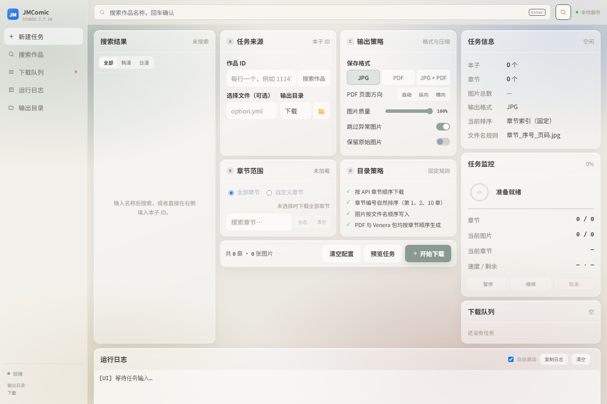
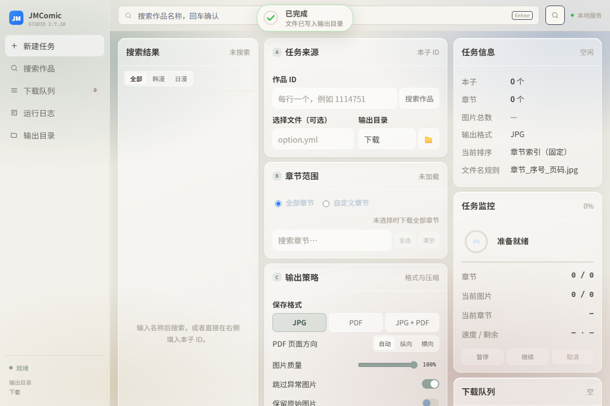

# JMComic Studio

> 一个跑在本机的 JMComic 下载工作台：搜索、选章、排队下载、实时进度、导出 Venera 包。<br>
> 基于 [hect0x7/JMComic-Crawler-Python](https://github.com/hect0x7/JMComic-Crawler-Python) 的本地 Web UI 分支。

<p align="center">
  
</p>

---

## 目录

- [功能](#功能)
- [界面](#界面)
- [技术栈](#技术栈)
- [快速开始](#快速开始)
- [使用方法](#使用方法)
- [部署](#部署)
- [HTTP API](#http-api)
- [目录结构](#目录结构)
- [常见问题](#常见问题)
- [许可证](#许可证)

---

## 功能

### 搜索与详情

- 关键词搜索本子，支持「全部 / 韩漫 / 日漫」分类；
- 搜索结果带**真实封面缩略图、作者、章节数、总页数**（服务端代理封面，避免跨域与防盗链）；
- 点选结果自动填入本子 ID，并加载完整章节目录。

### 任务编排

- 本子 ID / 章节 ID 批量粘贴，空格、逗号、分号、换行都能识别；
- 章节列表可搜索、全选、清空；勾选任意章节自动切换为「自定义章节」；
- 不选章节时下载整本，选章节时只下指定章节；
- 任务进入**内存队列顺序执行**，侧栏实时显示队列数量与状态。

### 多源搜索与补章

JM 单源常有章节缺失，这一版支持接入第二个站点（当前为**肉漫天堂 `rmtt5.com`**）：

- 搜索时可选「所有源 / JM / 肉漫天堂」，结果标注来源；
- A 卡填 JM 作品 ID 后点「合并补章」，**留空补充源会自动按标题匹配**（实测 `秘密教學 / 秘密の授業` → 肉漫天堂 `秘密教学`）；也可手动填 ID；
- 以 JM 为主源，主源话号集合里没有的章节才从补充源补齐（实测 355 章 vs 335 章，补 20 章）；
- 合并时用补充源的标题**回填 JM 的数字章节名**（`4-6` → `第4话-夜晚到访的子豪`，实测回填 160 条）；
- 「只补缺章」按钮可跳过主源，直接下载比对出来的补充章节；
- 补充章节按 `输出目录/本子名/第N话/` 落盘，并**打包进 `Venera-导入/[JM本子名].zip`**，可直接导入 Venera（已存在同名 ZIP 时追加，重复条目自动跳过）；
- 图片 CDN 会重置连接，直链下载带**重试 + 多域名轮换 + 节流**（实测 90/90 张、零失败）。

> 适配层在 `site_sources.py`，新增站点只需实现 `search / album / chapter_images` 三个方法。

### 下载控制

| 能力 | 说明 |
| --- | --- |
| 开始 / 预览 | 预览走 dry-run，不联网、不写文件 |
| 暂停 / 继续 | 在图片边界阻塞，已发出的请求先完成，不会强断连接 |
| 取消 | 走 jmcomic 的 `DownloadControl`，正在下载的图片会正常收尾 |
| 进度 | 章节 done/total、图片 done/total、当前章节、实时速度、剩余时间 |
| 完成摘要 | 章节数、图片数、PDF 页数、异常图片数，可一键打开输出目录 |

### 输出策略

- **保存格式**：JPG / PDF / JPG + PDF；
- **PDF 页面方向**：自动、纵向、横向（按 A4 版面用 `img2pdf` 重新排版）；
- **图片质量**：50%–100%，低于 100% 时对 JPG 重新编码；
- **跳过异常图片**：关闭后只要有一张失败，整个任务判为失败；
- **保留原始图片**：开启后 Venera 导出完不再清理原始图片；
- **Venera 导出**：每本生成一个 `[JMxxxx].zip`，章节子目录保留，按章节号 + 页码自然排序，可直接导入 Venera。

### 界面细节

- 顶部**灵动岛**：下载时环形进度 + 百分比，完成后对勾描边动画，失败/取消变红；
- 日志按 `时间 / 级别 / 内容` 分列，ERROR 红、WARNING 黄、成功绿，支持自动滚动、复制、清空；
- `Ctrl + K` 聚焦搜索框，`Enter` 直接搜索；
- 只监听 `127.0.0.1`，不对外网开放。

---

## 界面

| 主界面 | 完成状态 |
| --- | --- |
|  |  |

---

## 技术栈

| 层 | 选型 |
| --- | --- |
| 下载内核 | [jmcomic](https://github.com/hect0x7/JMComic-Crawler-Python)（同步 API + 自定义 Downloader） |
| Web 服务 | Python 标准库 `ThreadingHTTPServer`，无 Web 框架依赖 |
| 进度采集 | 继承 `JmDownloader`，重写 `before_album/before_photo/after_image/after_photo` 钩子 |
| 任务队列 | 单 worker 线程 + `threading.Event` 实现暂停/继续 |
| 封面代理 | `curl_cffi` 模拟浏览器指纹抓取 CDN 封面，内存缓存 |
| PDF | `img2pdf`（可指定 A4 纵向/横向版面） |
| 图片压缩 | `Pillow` 重编码 JPG |
| 打包 | `py7zr` / `pyzipper` / `img2pdf` 等官方插件 |
| 前端 | 原生 HTML/CSS/JS，无框架、无构建步骤；`fetch` 轮询 `/api/status` |

### 架构

```text
浏览器 (单页, 原生 JS)
   │  fetch 轮询 /api/status
   ▼
ThreadingHTTPServer (gui.py 路由 + 静态页)
   │
   ▼
JobManager (gui_backend.py)
   ├─ 任务队列 + worker 线程
   ├─ ProgressTracker (线程安全进度)
   ├─ 搜索补全 / 章节详情 / 封面缓存
   └─ GuiDownloader(JmDownloader) ──► jmcomic 下载内核
                                        ├─ 图片下载 / 解密
                                        ├─ PDF (img2pdf)
                                        └─ Venera ZIP 导出
```

---

## 快速开始

### 环境要求

- Windows 10/11（其他平台理论可用，路径与 `os.startfile` 做了兼容）
- Python 3.10+（推荐 3.12）
- 能访问 JM 站点与 CDN 的网络环境

### 安装

```powershell
git clone https://github.com/<your-name>/JMComic-Studio.git
cd JMComic-Studio

python -m venv .venv
.\.venv\Scripts\python.exe -m pip install -U pip
.\.venv\Scripts\python.exe -m pip install -e ".[plugins]"
```

> 用 uv 也可以：`uv venv --python 3.12 --seed .venv`，再 `uv pip install -e ".[plugins]"`。

### 启动

```powershell
.\.venv\Scripts\python.exe -m jmcomic.gui --port 8766
```

打开 <http://127.0.0.1:8766/>。默认只监听本机，不会暴露到局域网。

> 端口被占用时换一个：`--port 8767`。

---

## 使用方法

1. **搜索**：顶部输入本子名，回车或点搜索；结果里能看到封面、作者、章节数和页数。
2. **填入 ID**：点搜索结果会自动填入 A 区「作品 ID」；也可以手动粘贴多个 ID。
3. **加载章节**：点「搜索作品」读取章节目录；不选章节就是整本下载。
4. **选择章节**（可选）：B 区勾选任意章节会自动切到「自定义章节」；支持章节搜索、全选、清空。
5. **设置输出**：C 区选格式（JPG / PDF / 两者）、PDF 方向、图片质量、是否跳过异常图、是否保留原图。
6. **开始下载**：底部「开始下载」入队执行；「预览任务」只走 dry-run，不联网。
7. **看进度**：右侧任务监控显示章节/图片/速度/剩余时间，顶部灵动岛同步环形进度。
8. **完成后**：完成摘要会给出章节、图片、PDF 页数、异常图片数；「打开输出目录」直接弹资源管理器。

### 输出结构

```text
下载/
├─ 本子名称/
│  ├─ 第1话/
│  │  ├─ 00001.jpg
│  │  └─ ...
│  └─ 第1话.pdf
└─ Venera-导入/
   └─ [JMxxxx].zip
```

---

## 部署

### 本机常驻（推荐）

新建 `start-jmcomic.bat`：

```bat
@echo off
cd /d D:\Code\JMComic-Studio
.\.venv\Scripts\python.exe -m jmcomic.gui --port 8766
pause
```

需要开机自启时，用「任务计划程序」创建登录时触发的任务，指向这个 bat 即可。

### 局域网访问（谨慎）

默认只绑定 `127.0.0.1`，这是有意的安全设计。确实需要局域网访问时：

```powershell
.\.venv\Scripts\python.exe -m jmcomic.gui --host 0.0.0.0 --port 8766
```

> 界面没有登录鉴权，暴露到局域网等于把下载器和输出目录交给同网段所有人。建议只在本机使用，或用反向代理加 Basic Auth + HTTPS。

### 反向代理示例（Nginx）

```nginx
location / {
    auth_basic "JMComic";
    auth_basic_user_file /etc/nginx/.htpasswd;
    proxy_pass http://127.0.0.1:8766;
    proxy_set_header Host $host;
}
```

### Docker

> 当前 UI 依赖 Windows 的「打开输出目录」，容器内该按钮不可用；下载与导出功能正常。

```dockerfile
FROM python:3.12-slim
WORKDIR /app
COPY . .
RUN pip install --no-cache-dir -e ".[plugins]"
EXPOSE 8766
CMD ["python", "-m", "jmcomic.gui", "--host", "0.0.0.0", "--port", "8766", "--no-browser"]
```

```bash
docker build -t jmcomic-studio .
docker run -p 8766:8766 -v $PWD/下载:/app/下载 jmcomic-studio
```

---

## HTTP API

| 方法 | 路径 | 说明 |
| --- | --- | --- |
| GET | `/` | 单页界面 |
| GET | `/api/status` | 当前任务、进度、队列、最近 300 行日志 |
| GET | `/api/album?id=&source=` | 本子详情 + 完整章节目录（source: jm / rmtt） |
| GET | `/api/merge?id=&source=&extra=` | 跨源合并：主源章节 + 需补充的章节 |
| GET | `/api/sources` | 可用来源列表 |
| GET | `/api/cover?id=&source=` | 封面代理（JPEG） |
| POST | `/api/search` | `{query, category, source, option}` |
| POST | `/api/start` | `{albums, photos, option, output, format, dry_run, quality, pdf_orientation, skip_bad, keep_raw, supplement, supplement_title}` |
| POST | `/api/pause` / `resume` / `cancel` | `{id}`，省略 id 时作用于当前任务 |
| POST | `/api/open-folder` | `{path}`，在资源管理器中打开 |

---

## 目录结构

```text
JMComic-Studio/
├─ src/jmcomic/
│  ├─ gui.py            # HTTP 路由 + 单页界面（HTML/CSS/JS 均在此）
│  ├─ gui_backend.py    # 任务队列、进度、搜索补全、封面代理、PDF/压缩、跨源合并
│  ├─ site_sources.py   # 第二来源适配层（搜索 / 章节 / 图片直链 + 重试）
│  ├─ jm_downloader.py  # 上游下载内核
│  └─ ...               # 上游其余模块
├─ docs/images/         # README 截图
├─ pyproject.toml
└─ setup.py
```

---

## 常见问题

**Q：启动后浏览器打开是空白？**
A：确认用项目 `.venv` 的 Python 启动，并访问 `http://127.0.0.1:8766/` 而不是 `https`。

**Q：搜索很慢？**
A：搜索会为本子补全详情（作者/章节数/页数），最多并发 4 个请求。网络差时会慢 2–5 秒。

**Q：暂停后还在下载？**
A：暂停在「图片边界」生效，已经发出的请求会先完成，最多几张图的延迟。

**Q：PDF 页数为什么等于图片数？**
A：PDF 由每章图片直接生成，一图一页。

**Q：输出目录里没有 Venera-导入？**
A：它在输出目录的**上一级**；例如输出 `D:\下载`，ZIP 在 `D:\Venera-导入`。

---

## 许可证

本项目基于 [hect0x7/JMComic-Crawler-Python](https://github.com/hect0x7/JMComic-Crawler-Python)，遵循 MIT License，见 [LICENSE](LICENSE)。

仅供个人学习与技术研究，请遵守当地法律法规，不要用于商业用途或大规模抓取。
